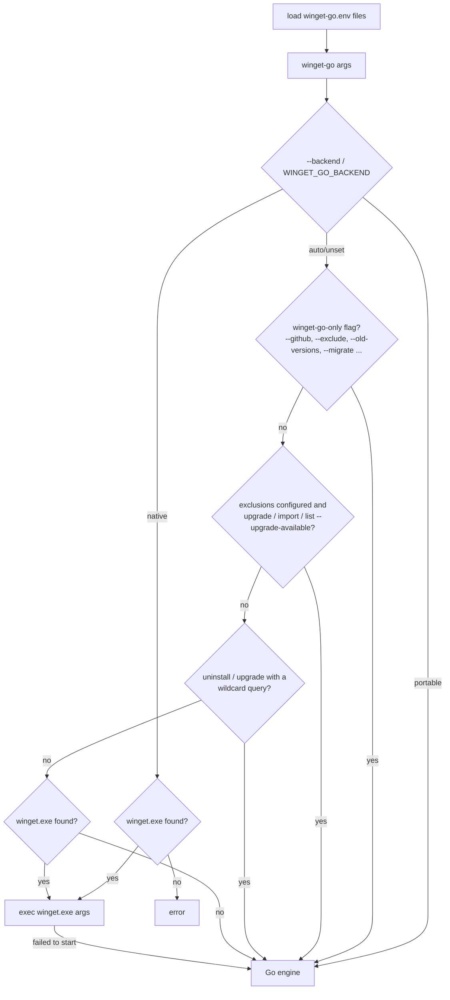
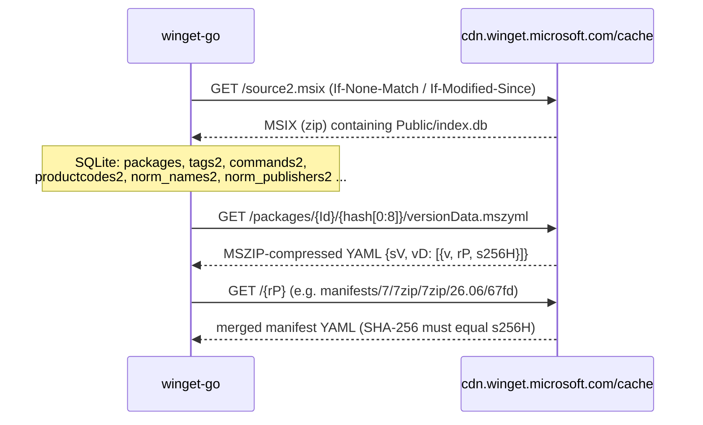
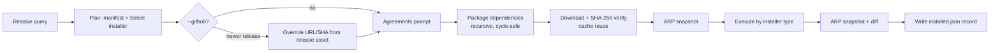

# winget-go Architecture

> **Keep this document current.** Any change that adds, removes or reshapes a
> package, command, backend, on-disk format or data flow must update the
> relevant section here in the same commit. See [Maintaining this document](#maintaining-this-document).

## 1. Goals

winget-go is a Go implementation of the [winget](https://github.com/microsoft/winget-cli) client that:

1. **Delegates to native winget** when it is available on Windows, so behaviour is identical to winget there.
2. **Works without winget**, e.g. on Windows Server / LTSC / Windows Sandbox / Server Core, under `SYSTEM`, or wherever App Installer is missing or broken. It reads the same community source as winget and installs packages itself.
3. **Runs on macOS and Linux** for read-only and staging tasks (`search`, `show`, `download`, `hash`, `source`), e.g. to prepare offline installers.
4. **Optionally uses GitHub Releases** to pick up newer versions of GitHub-hosted packages before their winget manifests are updated.
5. **Supports exclusion lists** (configured once in a `winget-go.env` file) so bulk upgrades and imports skip packages that are pinned or managed elsewhere.

It is a single static binary (`CGO_ENABLED=0`; SQLite is provided by the pure-Go `modernc.org/sqlite`).

## 2. Backend selection

* Implemented in [`internal/backend`](../internal/backend) and [`cmd/winget-go/main.go`](../cmd/winget-go/main.go).
* `--backend` is stripped before the remaining args are passed through **verbatim** to native winget, which keeps stdio and the exit code.
* Native winget discovery ([`platform.FindNativeWinget`](../internal/platform/platform_windows.go)) checks `PATH`, the App Execution Alias in `%LOCALAPPDATA%\Microsoft\WindowsApps`, then, **only when running as `SYSTEM`**, `%ProgramFiles%\WindowsApps\Microsoft.DesktopAppInstaller_*`. Any other account gets "Access is denied" executing from there. That includes an elevated admin for whom App Installer was never registered: such an account has no alias and uses the portable backend. If native winget is found but fails to start, `main` warns (naming the path and the OS reason, and suggesting `WINGET_GO_BACKEND=portable`) and falls back to the portable backend. It never returns its own executable, so it is safe to install winget-go as `winget.exe`.
* Env files (§8) are loaded **before** the decision, because they may set `WINGET_GO_BACKEND` or exclusions.
* Native winget has no exclusion support. When exclusions are configured, commands that honour them run on the portable backend in auto mode. An explicit `--backend native` gets a warning that the exclusions are ignored.
* Native winget treats `*` in a query literally, so an `uninstall`/`remove`/`rm` or `upgrade`/`update` whose positional query or flag value contains `*`, `?` or `[` runs on the portable backend in auto mode. An explicit `--backend native` gets a warning.
* `WINGET_GO_DEBUG=1` prints the decision; `winget-go --info` (portable backend) shows it too.

## 3. Package map

| Package | Responsibility |
|---|---|
| `cmd/winget-go` | Entry point: backend decision, passthrough, signal handling, exit codes. |
| `internal/backend` | `auto` / `native` / `portable` resolution and native passthrough. |
| `internal/cli` | Cobra command tree that mirrors winget's commands and flags (`-h` = `--silent`, so help is `--help`). Renders winget-style tables. |
| `internal/engine` | The portable backend's operations: resolve, plan, download, install, upgrade, uninstall (including old-version cleanup planning), export/import. Coordinates every package below. |
| `internal/source` | Pre-indexed source v2: index download/extract, SQLite queries, version data, manifest fetch and verification, ARP name normalization. |
| `internal/mszyml` | Decoder for `.mszyml` (Windows Compression API buffer with MSZIP blocks). |
| `internal/manifest` | Merged-manifest model, root-to-installer default merging, localization overlay. |
| `internal/installer` | Installer selection, default switches per technology, argument building, exit codes, execution, portable/zip installs, uninstall command parsing. |
| `internal/installed` | winget-go install records (`installed.json`), ARP snapshots/diffs, correlation of installed apps to packages. |
| `internal/github` | GitHub Releases lookup, asset matching, digest-based hashes, response cache. |
| `internal/platform` | OS boundary: process launch + UAC elevation (`ShellExecuteExW runas`), ARP registry enumeration, MSIX enumeration/removal (Windows PowerShell `Get-AppxPackage` / `Remove-AppxPackage`, manifest display names via `SHLoadIndirectString`), user `PATH` edits, native winget discovery. Off Windows, these are stubs. |
| `internal/httpx` | Shared HTTP client, User-Agent, streaming download with progress and SHA-256. |
| `internal/config` | On-disk locations, `sources.json`, environment settings, `winget-go.env` discovery/parsing, version string. |
| `internal/exclude` | Exclusion lists: pattern parsing (globs on Id, `name:` globs on display name), loading from env/env files/flags/list files, matching. |
| `internal/version` | winget-compatible version comparison and version-line prefixes (`Prefix`). |

Dependency direction: `cli → engine → {source, installer, installed, github, exclude} → {manifest, platform, httpx, config, version, mszyml}`. `platform` imports nothing internal, which keeps the OS-specific surface small.

## 4. The winget community source (format v2)

winget-go uses the same CDN as winget, `https://cdn.winget.microsoft.com/cache`:

* **Index**: `packages(rowid, id, name, moniker, latest_version, arp_min_version, arp_max_version, hash)` plus `*2` mapping tables. The schema `majorVersion` must be `2`.
* **Version data**: the `packages.hash` column (SHA-256) makes the URL content-addressed, so cached version data stays valid until the hash changes.
* **`.mszyml`**: 24-byte header (`0A 51 E5 C0` signature, uncompressed size, chunk size), followed by blocks of `uint32 size` + `"CK"` + raw DEFLATE. Each block uses the previous block's output as its preset dictionary.
* **Manifests** are *merged* (version + locales + installers in one YAML file). Root-level installer fields (`Scope`, `InstallerType`, `InstallerSwitches`, …) act as defaults for every installer; `manifest.Parse` merges them, and switches are merged key by key. Locales live under `Localization`.
* **Refresh**: the index is refreshed when it is older than `WINGET_GO_AUTOUPDATE_MINUTES` (default 15). Requests are conditional, so an unchanged index costs one 304. If a refresh fails but a cached index exists, winget-go warns and continues.

Search runs one SQL query per field (id, name, moniker, tag, command) with escaped `LIKE` patterns, or `= COLLATE NOCASE` for `--exact`. It ranks results by match type (exact → case-insensitive → prefix → substring), then by field. `install`/`show`/`download` search only id, name and moniker, like winget, and `Resolve` prefers a case-insensitive exact id match.

Additional sources of type `Microsoft.PreIndexed.Package` can be added with `source add`. REST sources and the `msstore` source are not supported.

## 5. Install pipeline (portable backend)

**Installer selection** (`installer.Select`): filter by architecture (system preference order, e.g. arm64 → x64 → x86 → neutral on ARM64; `-a` forces one), `--scope`, `--installer-type`, `--installer-locale` and platform (`Windows.Desktop` or `Windows.Universal`; MSIX packages such as PowerShell 7.7 are Universal-only). When nothing is left, the error lists each installer with the reason it was rejected. Then rank by: not-Store, architecture preference, locale match (`LANG`/`WINGET_GO_LOCALE`), and scope preference (machine when elevated, user otherwise). On non-Windows hosts the target is assumed to be Windows x64.

**Arguments** (`installer.BuildArgs`): manifest switches override winget's built-in defaults per technology:

| Type | Silent | Silent with progress | Log | Location |
|---|---|---|---|---|
| msi / wix | `/quiet /norestart` | `/passive /norestart` | `/log "<LOGPATH>"` | `TARGETDIR=… INSTALLDIR=…` |
| burn | `/quiet /norestart` | `/passive /norestart` | `/log "<LOGPATH>"` | – |
| nullsoft | `/S` | `/S` | – | `/D=<path>` (always last) |
| inno | `/SP- /VERYSILENT /SUPPRESSMSGBOXES /NORESTART` | `/SP- /SILENT …` | `/LOG="<LOGPATH>"` | `/DIR="<path>"` |
| exe | manifest only | manifest only | manifest only | manifest only |

Order: mode → log → scope (`/CURRENTUSER`/`/ALLUSERS` for Inno, `ALLUSERS`/`MSIINSTALLPERUSER` for MSI) → `Upgrade` (on upgrade) → manifest `Custom` → `--custom` → location. `--override` replaces everything.

**Execution** (`installer.Execute`, Windows only):

| Type | How |
|---|---|
| msi / wix | `%SystemRoot%\System32\msiexec.exe /i "<file>" <args>` |
| msix / appx | PowerShell `Add-AppxPackage` (`Add-AppxProvisionedPackage` for `--scope machine`) |
| exe / inno / nullsoft / burn | The file itself, with a raw command line (`SysProcAttr.CmdLine`) so switches such as `/D=C:\Program Files\X` are not re-quoted |
| portable | Copy to `<data>\Packages\<Id>\<alias>.exe`, then link it into `<data>\Links` |
| zip | Extract with zip-slip protection, then either install as portable (`NestedInstallerType: portable`, all `NestedInstallerFiles` get links) or run the first nested installer |

**Elevation**: UAC (`ShellExecuteExW` with `runas`, waiting on the process handle) is used when the process is not elevated and either the manifest says `elevationRequired`, or it is an MSI/WiX machine-scope install. It is also used as a retry whenever Windows returns `ERROR_ELEVATION_REQUIRED` (740). `elevatesSelf` / `elevationProhibited` are respected.

**Portable links**: a symlink `<alias>.exe` is created when permitted (admin or Developer Mode); otherwise a `<alias>.cmd` shim is written. `<data>\Links`, or the install directory when `ArchiveBinariesDependOnPath` is set, is appended to the user `PATH` (`HKCU\Environment`), and `WM_SETTINGCHANGE` is broadcast.

**Exit codes**: `0`, `3010` and `1641` (reboot) count as success, as does anything listed in `InstallerSuccessCodes`. Other codes are explained with `ExpectedReturnCodes` and well-known MSI codes.

**Install technology on upgrade**: `upgrade` passes the installed item, and `engine.InstalledTech` derives its technology from the winget-go record, MSIX registration or ARP (`WindowsInstaller` / msiexec uninstall → msi). Unless `--installer-type` is given, `installer.Select` then only considers installers of the same `TechFamily`: msi (msi, wix), msix (msix, appx), exe (exe, inno, nullsoft, burn) or portable. This is because an MSIX does not replace an MSI install; it lands beside it. If only other technologies are available, it returns `TechMismatchError` ("only available as msix, but the installed copy is an MSI install; pass --migrate … or --installer-type msix …"), as native winget does. Unknown technology (plain exe uninstallers) is unrestricted.

**Technology migration** (`upgrade --migrate`, `Request.Migrate`): `engine.selectForUpgrade` retries a `TechMismatchError` without the restriction and records the old family in `Plan.MigrateFrom`. An installer of the current technology still wins when one exists. `install` then:

1. Downloads and hash-verifies the new installer.
2. Uninstalls the old copy (`Request.Installed`) silently. If this fails, nothing has changed.
3. Runs the new installer as a fresh install (`ArgOptions.Upgrade` is false) and does not carry over the old record's ARP keys.

If step 3 fails, the error says the old copy is already gone and gives the verified installer's path and an `install --id … -e` retry command. `--migrate` is a winget-go flag, so it forces the portable backend.

**Upgrade targets**: `upgrade --all` takes every non-excluded upgrade. `upgrade <query>` uses `MatchInstalled`. A plain query must resolve to one package; an excluded one errors with a `--no-exclude` hint. A **wildcard** query acts like a filtered `--all`: excluded matches are skipped and reported, every other match is upgraded with no prompt (the same as `--all`), and no match means exit 0. Targets are deduplicated by package Id, because several ARP entries can map to one package.

**Upgrade** (`engine.Upgrades`): installed items whose matched package has a higher `latest_version` (or a newer GitHub release with `--github`). Each result carries `ExcludedBy` when it matches the exclusion list (§8); excluded packages skip the GitHub lookup. `UpgradeBehavior: uninstallPrevious` uninstalls first; `deny` refuses.

**Uninstall**: portable records → delete links and directory. MSIX packages → `Remove-AppxPackage -Package <FullName>` for the current user. `NonRemovable` packages are refused. The script turns off progress records, catches the exception itself and prints `0x<HRESULT>` plus the message as plain text. This avoids PowerShell's CLIXML error stream; `platform.DecodeCLIXML` decodes that stream if it shows up anyway. `platform.ParseMSIXError` strips the ActivityId/script-position noise into an `MSIXError`. A framework in use (`0x80073CF3`) becomes "in use by <dependents>". A package already gone (`0x80073CF1`, e.g. a framework Windows removed together with its last dependent) counts as success. ARP entries → `msiexec /x {ProductCode}` for Windows Installer products; otherwise `QuietUninstallString`; otherwise `UninstallString` plus technology-specific silent switches (based on the recorded or manifest installer type). After a successful uninstall, only the removed ARP key is dropped from the package's record; the record itself is deleted once it has no keys left. This keeps side-by-side versions tracked correctly.

**Bulk confirmation** (`confirmBulk`): `--disable-interactivity` proceeds without asking. On a TTY it prompts Y/N. With no TTY and no flag it refuses, so a script can't remove more than intended.

**Matching installed packages** (`engine.MatchInstalled`, through `engine.FindInstalled` for `uninstall` and `uninstall --old-versions`, and directly over the upgradable items for `upgrade <query>`): a plain term prefers an exact Id match, then exact names (`-e`) or Id/name substrings. A term containing `*`, `?` or `[` is a case-insensitive `path.Match` glob that must match the **whole** Id or display name. Backslashes are literal, so `ARP\Machine\X64\…` and `MSIX\…` Ids can be matched as written. Invalid patterns are an error. For a wildcard `uninstall`, the CLI drops excluded entries (§8). When more than one entry matches, it lists them and asks for confirmation (`confirmBulk`). `--all-versions` is not needed, because the pattern already says "many". A plain term that matches several entries still requires `--all-versions`. Bulk uninstalls go through `uninstallEach`. It removes MSIX frameworks last, so their dependents are gone first. It keeps going after a failure, prints a one-line reason per failure, and ends with a summary that says how many failures were frameworks still in use. Tables and messages show the architecture (`Item.Arch`, `Item.Label`) because MSIX frameworks are often installed as both x64 and x86.

**Old-version cleanup** (`uninstall --old-versions[=major|minor|all] [--keep N] [--dry-run]`): `engine.PlanOldVersions` is a pure function over installed items, so it is unit-tested without Windows.

1. **Product key**: for MSIX, the package family name plus architecture. Several families can map to one winget Id (a runtime's framework, Main, Singleton and DDLM packages), and those must never be compared. Otherwise, the package Id when matched, otherwise `source.NameKey(displayName)` plus normalized publisher. Either way the architecture suffix and the ARP scope (user/machine) are part of the key, so x86/x64 and per-user/per-machine installs are never "old versions" of each other.
2. **Version line**: `version.Prefix(v, 1)` for `major`, `version.Prefix(v, 2)` for `minor`, and one line for `all`. Items with an empty or `Unknown` version are skipped.
3. **Selection**: each line is sorted newest first and the first `keep` items are kept. The rest are removed only if strictly older than the oldest kept version, so duplicates of a kept version are never touched.

The CLI applies the exclusion list (§8) before planning, prints a keep/REMOVE table, stops for `--dry-run`, and confirms via `confirmBulk`, then uninstalls each target and reports failures together. `--old-versions` uses `NoOptDefVal`, so a bare `major`/`minor`/`all` positional is rejected with a hint to use `=`.

## 6. Installed-app correlation

`installed.List` merges:

1. **ARP entries** from `HKLM` (64-bit and 32-bit views) and `HKCU` `…\CurrentVersion\Uninstall`. System components and updates are skipped. Keys use native winget's Id format (`Machine\X64\…`, `Machine\X86\…`, `User\X64\…`), so Ids copied from native `winget list` work. Records written by older builds (`HKLM\…`, `HKLM32\…`, `HKCU\…`) are translated by `platform.LegacyARPKey`.
2. **MSIX packages** registered for the current user. `platform.ReadMSIX` runs Windows PowerShell 5.1 `Get-AppxPackage` (passed with `-EncodedCommand`, output as JSON) and skips resource packages and bundles. It then reads `DisplayName`/`PublisherDisplayName` from each `AppxManifest.xml` and resolves `ms-resource:` references with `SHLoadIndirectString`. Packages match the source by **package family name** (`pfns2`). Unmatched ones get the Id `MSIX\<PackageFullName>`, as in winget. If PowerShell fails, `list` prints a warning and continues with ARP only.
3. **winget-go records** (`installed.json`). Each install snapshots ARP before and after running the installer and stores the keys that changed. This is the same technique winget uses, and it gives an exact package↔ARP mapping for anything winget-go installed.
4. For other ARP entries, matching falls back to **product code** (`productcodes2`, lowercased key name) and then to **normalized name** (`norm_names2`). Ties are broken by **normalized publisher** (`norm_publishers2`). `source.NormalizeName` approximates winget's `NameNormalizer`: it strips versions, locales and parentheticals, and emits arch-suffixed variants such as `mozillafirefox(X64)`.
5. **Portable records** that have no ARP entry. Records for MSIX installs link to the MSIX item by package Id.

MSIX versions are shown raw (e.g. `8000.675.1142.0`). winget instead maps them to the manifest version (e.g. `1.8.10`). They often don't compare with `PackageVersion`, so **MSIX items are left out of `upgrade`**.

## 7. GitHub Releases integration

Enabled with `--github` on `install`, `upgrade`, `download`, `show`, `list` and `import`, or globally with `WINGET_GO_GITHUB=1`. In `auto` mode, `--github` forces the portable backend.

1. An installer qualifies when its URL is `https://github.com/<owner>/<repo>/releases/download/<tag>/<asset>`.
2. winget-go calls `GET /repos/<owner>/<repo>/releases/latest`. Drafts and prereleases are ignored. Responses are cached for an hour in `<cache>/github`, then revalidated with `ETag` (a 304 does not count against the rate limit). `GITHUB_TOKEN`/`GH_TOKEN` raises the limit and is sent only to `api.github.com`.
3. The release is used only if its tag version (leading non-digits stripped: `v1.2`, `jq-1.8` → `1.2`, `1.8`) is newer than both the manifest version and the old tag.
4. **Asset matching** (`github.MatchAsset`): first an identical name; then substitution of version variants (`1.2.3`, `123`, `1_2_3`, `1-2-3`) from the old tag/version into the old asset name; then a unique structural match with digit runs masked (`7z#-x#.exe`). Ambiguity is an error, so winget-go falls back to the manifest.
5. **Integrity**: the expected SHA-256 comes from the asset's GitHub `digest` (`sha256:…`). If GitHub has no digest, installation is refused unless `--ignore-security-hash` is passed.
6. Installer switches, scope, type and dependencies still come from the manifest. MSI product codes are dropped because they change between versions.

`show --github` prints the latest release tag, date, URL and notes.

## 8. Settings files and exclusion lists

### `winget-go.env`

`config.LoadEnvFiles` runs first in `main`. It reads every existing file named `winget-go.env`, highest precedence first:

1. `config.ConfigDir()/winget-go.env`: `%APPDATA%\winget-go`, `~/Library/Application Support/winget-go` or `~/.config/winget-go` (or `$WINGET_GO_HOME/config`)
2. machine-wide: `%ProgramData%\winget-go\winget-go.env` or `/etc/winget-go/winget-go.env`
3. next to the executable (symlinks resolved), which suits a binary deployed to a share or with a management tool

`WINGET_GO_ENV_FILE` replaces the search with one file, which must then exist. The format is dotenv: `KEY=VALUE`, optional `export`, `#` comments, single/double quotes, and double-quoted values that may span lines. Precedence rules:

* **Scalar keys**: a real environment variable wins; otherwise the first file that sets the key wins.
* **List keys** (`WINGET_GO_EXCLUDE`, `WINGET_GO_EXCLUDE_FILE`): values from the environment and every file are **merged**, so a machine-wide list and a user list combine. These are read through `config.ListSetting`.
* Only `WINGET_GO_*`, `GITHUB_TOKEN` and `GH_TOKEN` are accepted. Other keys (e.g. `PATH`) are ignored with a warning.

### Exclusions

`exclude.Load` builds a `*exclude.List` from `WINGET_GO_EXCLUDE` (environment + files), the plain-text lists named by `WINGET_GO_EXCLUDE_FILE`, `--exclude` (repeatable, comma-separated) and `--exclude-file`. `--no-exclude` yields an empty list.

* Patterns are `path.Match` globs, lowercased on both sides, matched against the package Id. The `name:` prefix matches the display name instead. Lists split on `,` `;` and newlines, and `#` starts a comment. Invalid patterns are errors, never silently ignored.
* They apply to `upgrade` (the table, `--all`, and a named package, which errors with a `--no-exclude` hint), to `list` (the Available column shows `(excluded)`, and `--upgrade-available` hides excluded rows), to `import` (excluded entries are skipped) to `uninstall --old-versions` (excluded products are never removed) and to wildcard `uninstall` queries (excluded entries are skipped). They do not block an explicit `install` or an `uninstall` by plain name or Id.
* `winget-go --info` lists the env files searched, whether each was loaded, and the active patterns with their origin.

## 9. Platform support

| Capability | Windows + winget | Windows, no winget | macOS / Linux |
|---|---|---|---|
| All winget commands | native passthrough | – | – |
| search / show / hash / source | ✓ | ✓ | ✓ |
| download | ✓ | ✓ | ✓ (assumes x64 target unless `-a`) |
| install / upgrade / uninstall / import | ✓ | ✓ | ✗ (`ErrUnsupported`) |
| list / export | ✓ | ✓ (ARP + records) | records only (empty) |
| configure, pin, repair, settings, features, validate | native only | ✗ | ✗ |

## 10. Files on disk

`WINGET_GO_HOME`, if set, relocates everything to `<home>/{cache,config,data}`.

| What | Default location |
|---|---|
| Source index, version data, manifests, GitHub cache, cached installers | `os.UserCacheDir()/winget-go` (`%LOCALAPPDATA%\winget-go` on Windows) |
| `sources.json`, `winget-go.env` (user) | `os.UserConfigDir()/winget-go` (`%APPDATA%\winget-go`) |
| `winget-go.env` (machine) | `%ProgramData%\winget-go` or `/etc/winget-go`; also next to the executable |
| `installed.json`, `Packages\`, `Links\`, `logs\` | `%LOCALAPPDATA%\winget-go`; `$XDG_DATA_HOME/winget-go` or `~/.local/share/winget-go` elsewhere |

## 11. Security model

* Index and manifests come over HTTPS from the configured source. **The MSIX signature of `source2.msix` is not verified** (winget relies on the Windows package signature check). Manifests are verified against the SHA-256 in version data, which is in turn keyed by the index hash.
* Installers are always SHA-256-verified. A mismatch deletes the file and fails unless `--ignore-security-hash` is passed.
* Archive extraction rejects paths that escape the target directory.
* Package ids and cache file names are sanitized before use in paths.
* Native passthrough excludes winget-go's own executable to prevent recursion.
* Env files can only set winget-go's own settings and GitHub tokens, and no setting turns off hash verification. `--ignore-security-hash` is a flag only.

## 12. Known gaps vs. winget

* No `msstore` or REST (`Microsoft.Rest`) sources; no MSIX signature verification of the source package.
* No `configure` (DSC), `pin`, `repair` or `settings` in the portable backend.
* ARP correlation is heuristic for software not installed by winget-go, and ARP version ranges (`arp_min/max_version`) are not used yet.
* MSIX: per-user only (no `-AllUsers`/provisioned packages), raw MSIX versions, and no upgrades for MSIX items. Enumeration needs Windows PowerShell. No Windows feature/library dependency installation (reported only).
* Output is winget-style but not byte-identical.

## 13. Build, test, CI and dependency updates

* `go test ./...` runs offline. `internal/source` serves a synthetic v2 source (SQLite index in an MSIX, MSZIP version data, manifest) from `httptest`, and `internal/github` mocks the API.
* **CI** ([`.github/workflows/ci.yml`](../.github/workflows/ci.yml)): gofmt, `go vet` for the host and for `GOOS=windows`, and `go test -race` on Ubuntu, Windows and macOS. It then cross-compiles windows/{amd64,arm64,386}, linux/{amd64,arm64} and darwin/{amd64,arm64} and uploads the binaries as artifacts.
* **Release** ([`.github/workflows/release.yml`](../.github/workflows/release.yml)): pushing a `v*` tag builds every target with `-X winget-go/internal/config.Version=<tag>`, packages zips/tarballs (binary, README, CHANGELOG, LICENSE, `winget-go.env.example`) with `SHA256SUMS`, and creates a GitHub release. The notes are the tag's `## [x.y.z]` section of [`CHANGELOG.md`](../CHANGELOG.md); the job fails if that section is missing, so add the section before tagging.
* `internal/exclude` tests that the shipped `winget-go.env.example` parses and that its patterns are valid.
* **Renovate** ([`renovate.json`](../renovate.json)): weekly grouped PRs for Go modules (with `go mod tidy`), the Go toolchain directive and GitHub Actions (pinned to digests). Vulnerability alerts are raised immediately. The Renovate GitHub App must be installed on the repository.

## Maintaining this document

Update this file in the same change when you:

* add or remove a package or command, or change the backend decision rules (§2, §3);
* change how sources, version data or manifests are fetched, cached or verified (§4, §11);
* change installer selection, arguments, execution, elevation or state (§5, §6);
* change GitHub integration behaviour (§7), env-file or exclusion behaviour (§8; also update `winget-go.env.example`), platform support (§9), file locations (§10), or CI/Renovate (§13);
* close or open a gap relative to winget (§12).
